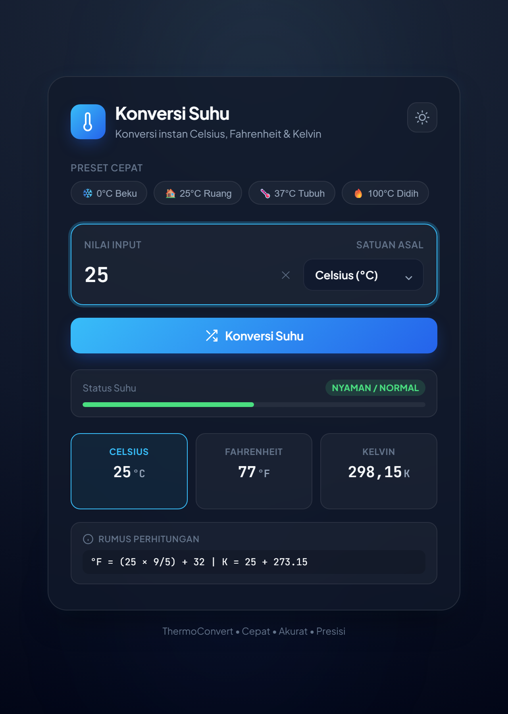

# ThermoConvert — Konversi Suhu

Aplikasi web sederhana untuk mengonversi suhu antara **Celsius**, **Fahrenheit**, dan **Kelvin** secara instan. Dibuat dengan HTML, CSS, dan JavaScript murni, tanpa framework dan tanpa proses build.



## Fitur

- Konversi otomatis saat mengetik (real-time)
- Preset cepat: titik beku (0 °C), suhu ruang (25 °C), suhu tubuh (37 °C), titik didih (100 °C)
- Indikator status suhu (dingin, sejuk, nyaman, hangat, panas)
- Klik kartu hasil untuk menyalin nilainya ke clipboard
- Menampilkan rumus perhitungan yang dipakai
- Validasi nol mutlak (tidak bisa di bawah 0 K / -273,15 °C)
- Mode terang dan gelap, mengikuti preferensi sistem dan tersimpan di browser
- Responsif untuk layar ponsel

## Cara Menjalankan

Tidak perlu instalasi apa pun. Pilih salah satu:

1. **Langsung:** buka file `index.html` di browser.
2. **Lewat server lokal** (disarankan, agar fitur salin ke clipboard berjalan penuh):

   ```bash
   # Node.js
   npx serve .

   # atau Python 3
   python -m http.server 8000
   ```

   Lalu buka `http://localhost:8000` (atau alamat yang ditampilkan).

## Rumus

| Dari → Ke | Rumus |
|---|---|
| Celsius → Fahrenheit | °F = (°C × 9/5) + 32 |
| Celsius → Kelvin | K = °C + 273,15 |
| Fahrenheit → Celsius | °C = (°F − 32) × 5/9 |
| Kelvin → Celsius | °C = K − 273,15 |

## Menjalankan Test

Logika konversi diuji dengan test runner bawaan Node.js (versi 20 ke atas), tanpa dependensi tambahan:

```bash
npm test
```

## Struktur Proyek

```
.
├── index.html      # Struktur halaman
├── style.css       # Tampilan, tema terang/gelap
├── converter.js    # Logika konversi murni (tanpa DOM), dipakai di browser dan test
├── script.js       # Interaksi halaman: input, hasil, tema, salin
├── favicon.svg     # Ikon aplikasi
├── package.json    # Skrip `npm test`
├── tests/
│   └── converter.test.js
└── assets/
    └── screenshot.png
```

## Lisensi

Dirilis di bawah [Lisensi MIT](LICENSE).
